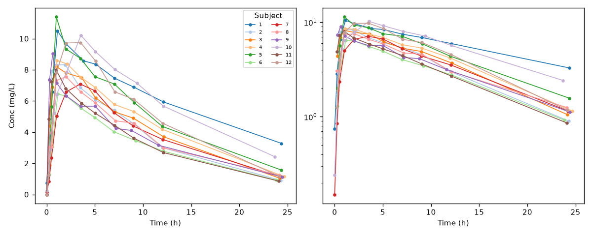
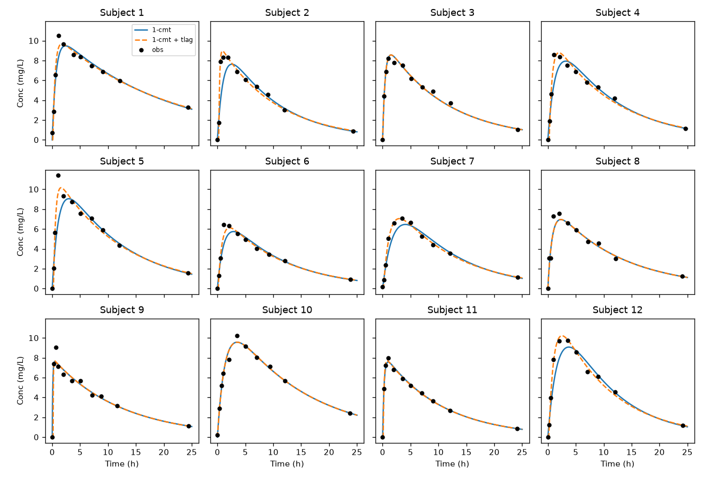
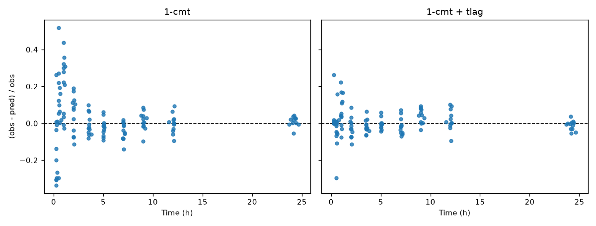
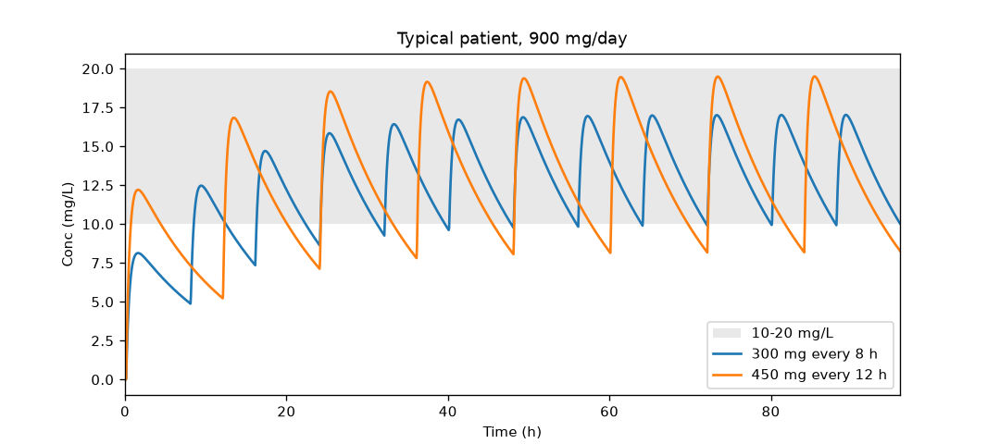
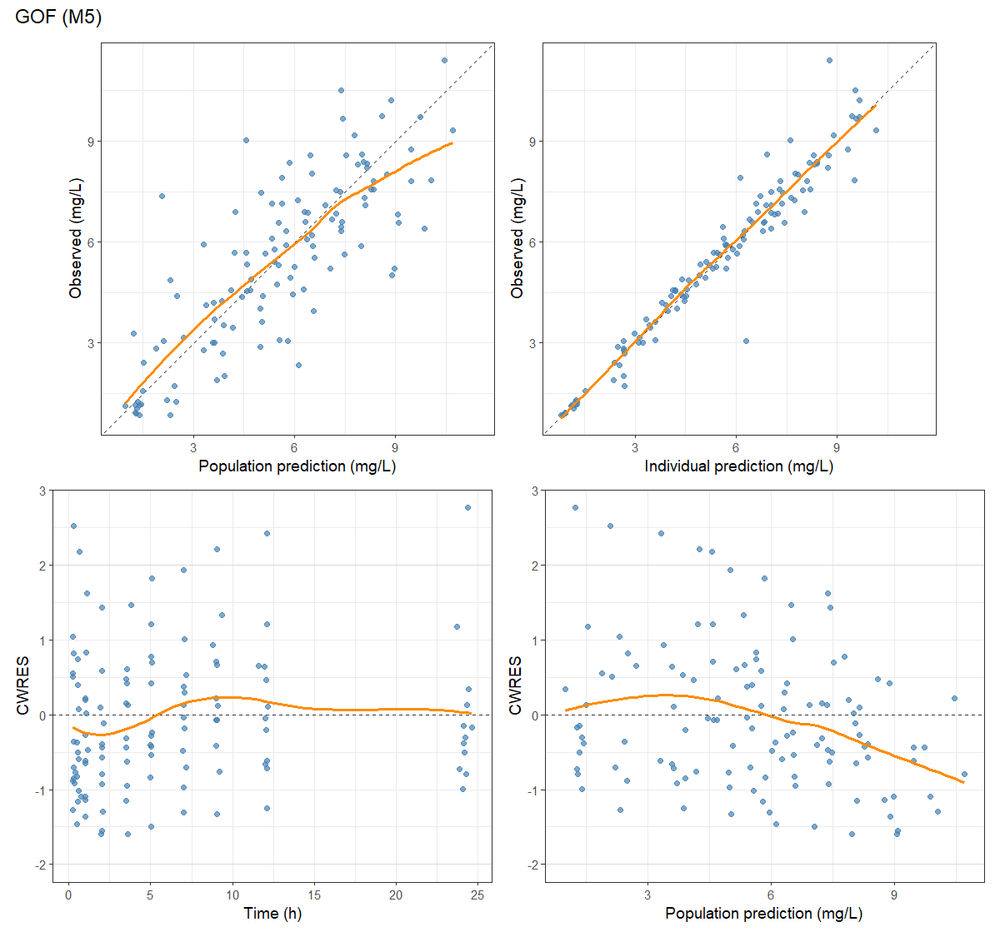
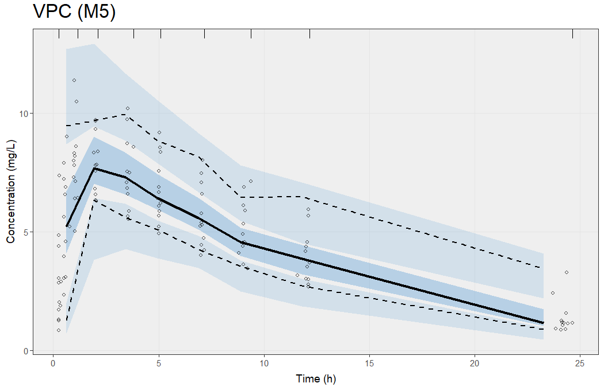
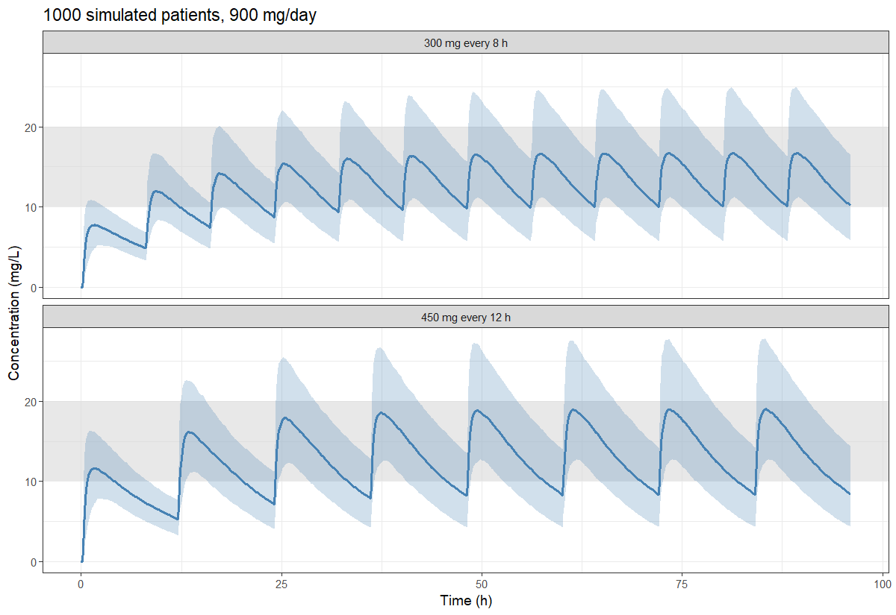

# theophylline PK (Theoph data)

PK analysis of the Theoph data (theophyline, single oral dose, 12 subjects, 11 samples in 25 h, Boeckmann, Sheiner & Beal 1994). I downloaded the csv from [Rdatasets](https://vincentarelbundock.github.io/Rdatasets/), it is in `data/theoph.csv`. Dose in the file is mg/kg, so I multiply it with body weight to get mg.

I learned Python before, so the individual fits are done in Python (`run_analysis.py`: NCA, fit each subject, dosing simulation for typical patient). For the population model I use R with nlmixr2 (`nlme_analysis.R`) because most of the tutorials I found are in R. The nlmixr2 details and the Python/R environment setup were done with help from an AI assistant.

```
pip install -r requirements.txt
python run_analysis.py
python -m pytest
Rscript nlme_analysis.R
```

I use Python 3.12 and R 4.5.3. For R you need nlmixr2, ggplot2, patchwork and vpc, on Windows also need Rtools. The R script read results/model_fits.csv, so please run the python script first.

## Data



Most subjects reach the peak in 1-2 h, but 3 subjects (7, 10, 12) are later, about 3.5 h. Cmax is 6.4-11.4 mg/L. In log scale the curves after the peak are nearly straight, so I think 1-cmt model is ok to start. In the log plot I removed the conc = 0 points at t = 0 (9 subjects), otherwise they can not be plotted.

## Individual fits (Python)

NCA: linear trapezoidal method, terminal slope is from the last 3 points, CL/F = Dose/AUCinf.
Model: C = Dose*ka/(V*(ka-ke)) * (exp(-ke*t) - exp(-ka*t)), fitted with `curve_fit`, sigma = C (so the weight is 1/C^2). I did not use the t = 0 samples, 3 subjects have small concentration before dosing and the model cannot give this.

mean +/- SD, n = 12

| | NCA | 1-cmt |
|---|---|---|
| CL/F (L/h) | 2.76 +/- 0.67 | 2.87 +/- 0.70 |
| V/F (L) | 31.2 +/- 5.8 | 32.1 +/- 5.6 |
| t1/2 (h) | 8.1 +/- 2.1 | 8.1 +/- 1.9 |
| ka (1/h) | | 2.0 +/- 2.8 (median 0.91) |
| Cmax (mg/L) | 8.8 +/- 1.5 | |
| Tmax (h) | 1.8 +/- 1.1 | |

CL/F from model is about 4% higher than NCA. ka is very different between subjects, for example subject 9 has ka about 10/h. The median SE of ka is 21% and for ke it is 12%, I think the reason is that there are only few points in the absorption phase so ka is hard to estimate.



### Lag time

In the first 2 h the residuals of 1-cmt model were big and almost all in one direction. So I added a tlag (not bigger than the first sample time). Mean |relative residual| before 2 h is 18.1% -> 6.0%, after 2 h 4.7% -> 3.6% (`results/residual_summary.csv`). AIC (n*ln(WRSS/n) + 2k) is better by more than 2 in 8 of 12 subjects, tlag = 0.13 +/- 0.09 h. For other 4 subjects the tlag is about 0, or the AIC did not change.



### Multiple dosing

900 mg per day, by superposition. For the typical patient I used arithmetic mean at first, but then ka become 2/h because of subject 9, so I changed to geometric mean. Now the typical patient is from the tlag fits: geometric mean for ka, CL/F and V/F (ka 2.33, CL/F 2.74, V/F 32.5), but median for tlag (0.14 h), because some subjects have tlag = 0 and then the geometric mean is also 0. With 300 mg q8h the steady state is 9.9-17.0 mg/L, with 450 mg q12h it is 8.2-19.5 mg/L (`results/multiple_dosing.csv`). It need about 27 h to reach 90% of steady state. So q8h is nearly inside 10-20 mg/L, but for q 12h the trough go down to about 8 mg/l.



## Population model (nlmixr2)

FOCE-I, etas are log-normal, t = 0 samples are also not used. I use covMethod = "r", because with the default the models with tlag fall back to "s" and the RSE of CL/F become 40-50%.

| | n par | OFV | dOFV |
|---|---|---|---|
| M1 1-cmt, eta on ka, CL, V, add + prop error | 8 | 121.5 | |
| M2 + tlag | 9 | 86.7 | -34.8 |
| M3 + WT (CL ~ WT^0.75, V ~ WT, exponents fixed) | 9 | 85.2 | -1.6 |
| M4 + CL-V eta correlation | 10 | 76.0 | -9.1 |
| M5 = M4 without additive error | 9 | 77.3 | +1.3 |

Weight almost has no effect. All subjects are 55-86 kg, and 11 of them got about 320 mg (subject 9 got 268 mg). I still keep it because the exponents are fixed and it not add parameter. I also tried two other versions of M5: without weight the OFV is 2.5 higher (same number of parameters), and when the exponent on CL is estimated it is 0.58 but RSE 126% (95% CI -0.85 to 2.02), so this data can not estimate it. Strange is that this OFV was 0.2 higher than with the fixed 0.75, maybe it stop at a local minimum. So I keep 0.75, the two models are commented out in `nlme_analysis.R` (with them the simulation numbers below changed a little, because the random numbers are different). The additive error had RSE 72% in M3, after I added the correlation it became only ~0.01 mg/L, so in M5 I only use proportional error. M5 is the final model.

| | estimate | RSE | BSV (CV) | shrinkage |
|---|---|---|---|---|
| ka (1/h) | 2.64 | 26% | 100% | -2% |
| CL/F, 70 kg (L/h) | 2.78 | 7% | 24% | -8% |
| V/F, 70 kg (L) | 33.3 | 4% | 13% | -1% |
| tlag (h) | 0.154 | 7% | | |
| prop. error | 11.6% | 8% | | |

corr(eta CL, eta V) = 0.55. For the thetas on log scale, RSE = SE x 100. The %RSE column in nlmixr2 is relative to the log value, so V/F looks like only 1%. tlag has no eta, because each subject only has one sample before ~0.3 h.



In CWRES vs PRED the line goes down above ~6 mg/L, it means the peak of typical patient is predicted a little too high. I hoped the CL-V correlation can fix it but the trend is still there. The VPC looks ok:



Other plots: [individual fits](figures/nlme_individual_fits.png), [eta vs WT, M2 vs M3](figures/nlme_eta_vs_weight.png).

### Dosing with variability

1000 virtual patients from M5 (etas with the CL-V correlation, weights resampled from the 12 subjects), steady state is the last dosing interval before 96 h:

| | median Cmin | median Cmax | whole interval in 10-20 | trough < 10 | peak > 20 |
|---|---|---|---|---|---|
| 300 mg q8h | 10.1 | 17.0 | 27% | 49% | 25% |
| 450 mg q12h | 8.4 | 19.5 | 3% | 70% | 45% |

For the typical patient q8h looked fine, but when BSV is included only about 1/4 of patients are in 10-20 for whole time (`results/nlme_regimens.csv`).



Some open questions are in `notes.md`.

Author: LIANG BIN (bin.liang.pharm@proton.me)
